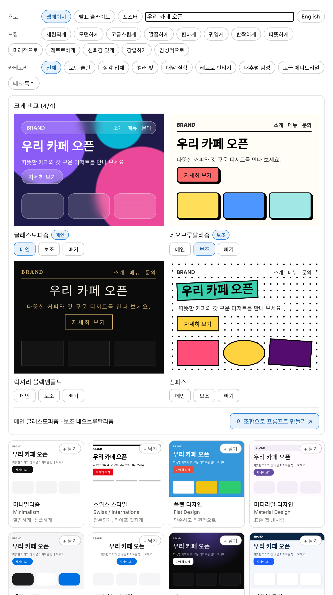
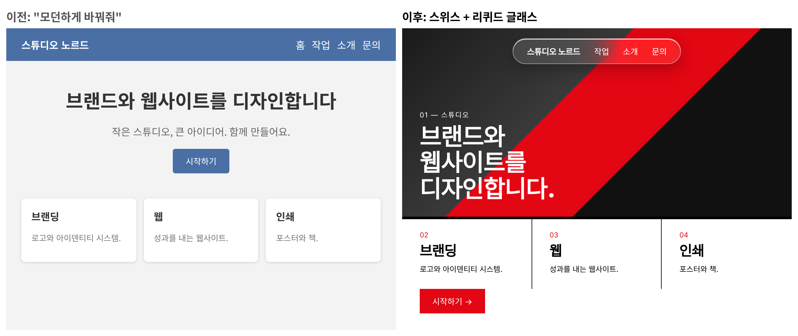

# Design Style Picker 🎨

[English](README.md) · **한국어**

> "세련되게 해줘", "모던하게 해줘" 대신, **디자인 스타일 53종을 눈으로 보고 골라서** AI가 정확히 따라 할 수 있는 디자인 프롬프트를 받으세요.

**디자인 스타일 이름을 모르겠다면?** 바로 이 스킬이 필요한 순간이에요.

Claude, Claude Code, Codex, Cursor, Gemini CLI 등 `SKILL.md`를 지원하는 AI 도구에서 쓰는 [에이전트 스킬](https://skills.sh)입니다.



---

## 왜 만들었나요?

디자인 스타일 이름을 모르니까 AI에게 "좀 더 세련되게", "모던하게", "고급스럽게"라고만 말하게 되고, 결과는 매번 비슷하게 무난합니다.

Design Style Picker는 글래스모피즘, 네오브루탈리즘, 벤토 그리드, 스위스 스타일, Y2K, 리퀴드 글래스, 글로시 등 **53가지 스타일을 미리보기 카드로** 보여 줍니다. 메인 스타일 1개와 보조 스타일 1개(선택)를 고르면 색상 코드, 모서리, 그림자, 서체, 피해야 할 것까지 적은 **구체적인 프롬프트**를 만들고, 작업 중인 결과물에 바로 적용할지 물어봅니다.

## 설치

### 가장 쉬운 방법: AI에게 부탁하기

Claude Code, Codex, Cursor, Gemini CLI 등 터미널을 쓸 수 있는 AI에게 이렇게 말하세요.

```
https://github.com/eminoart/design-style-picker 이 스킬 설치해줘
```

저장소에 [AGENTS.md](AGENTS.md), [CLAUDE.md](CLAUDE.md), [INSTALL.md](INSTALL.md)가 들어 있어서 AI가 무엇을 실행해야 할지 알고 알아서 설치합니다.

### 명령어 한 줄

```bash
npx skills add eminoart/design-style-picker -g -y
```

### 다른 방법

```bash
# macOS / Linux / WSL
curl -fsSL https://raw.githubusercontent.com/eminoart/design-style-picker/main/install.sh | bash
```
```powershell
# Windows PowerShell
irm https://raw.githubusercontent.com/eminoart/design-style-picker/main/install.ps1 | iex
```

| 도구 | 설치 방법 |
|---|---|
| Claude Code | 위 명령어, 또는 `~/.claude/skills/design-style-picker/` 에 복사 |
| Codex (CLI, IDE, 앱) | 위 명령어, 또는 `~/.agents/skills/design-style-picker/` 에 복사 |
| Cursor | 위 명령어, 또는 `~/.cursor/skills/`, `~/.claude/skills/`, `.agents/skills/` 중 한 곳에 복사 |
| Gemini CLI | 위 명령어, 또는 `~/.gemini/skills/` 나 `~/.agents/skills/` 에 복사 |
| **Claude 앱** (claude.ai, 데스크톱) | [`dist/design-style-picker.zip`](https://github.com/eminoart/design-style-picker/raw/main/dist/design-style-picker.zip) 을 내려받아 설정의 스킬(Skills) 메뉴에서 업로드 |
| **ChatGPT** (웹, 앱) | 프로젝트나 GPT를 만들고 지침에 `SKILL.md` 내용을 붙여 넣은 뒤, `styles.md` 와 `gallery.html` 을 파일로 업로드 |

자세한 내용: [INSTALL.md](INSTALL.md)

## 사용법

평소처럼 말하면 됩니다.

```
이 랜딩페이지 좀 모던하게 바꿔줘
디자인 스타일 보여줘
발표자료를 고급스럽게 만들고 싶어
```

1. **갤러리 보기**: Claude 앱에서는 채팅 안에, 코딩 도구에서는 브라우저에 갤러리가 열립니다. 모든 스타일이 **같은 화면**(메뉴, 제목, 버튼, 카드)으로 나와서 내용이 아니라 스타일만 비교됩니다.
2. **내 것으로 보기**: 용도 탭(웹페이지, 발표 슬라이드, 포스터)을 바꾸고 내 문구를 넣으면 모든 미리보기가 바뀝니다. "세련되게", "고급스럽게", "귀엽게" 같은 칩을 누르면 53개가 4개로 좁혀집니다.
3. **크게 비교**: 마음에 드는 스타일을 최대 4개까지 담으면 위쪽에 크게 나란히 보여 줍니다.
4. **고르기**: 메인 1개, 원하면 보조 1개를 정합니다.
5. **프롬프트 받기**: 추가 질문 없이 설명과 영어 프롬프트를 바로 받습니다. 어디에 쓸지는 고른 용도 탭이나 대화 내용으로 정합니다.
6. **바로 적용**: 세션에 이미 작업 중인 디자인(웹페이지, 코드, 슬라이드, 스크린샷)이 있으면 그것을 기준으로 삼아, 그 작업에 맞춘 프롬프트를 만듭니다. 그다음 객관식 팝업으로 "바로 적용 / 프롬프트만 받기 / 다른 스타일 다시 고르기"를 묻습니다. 작업 중인 것이 없으면 고른 용도로 예시를 만들어 볼지 물어봅니다.

> 설명은 사용자가 쓰는 언어(한국어 또는 영어)로 나옵니다. 프롬프트는 항상 영어로 만듭니다. AI 디자인 도구는 영어 스타일 용어를 가장 정확하게 따르기 때문이에요.

## 실제 활용 예시

### 1. 랜딩페이지 리디자인 (Claude Code, Cursor, Codex)

> **나:** 이 랜딩페이지 좀 모던하게 바꿔줘
> **AI:** "모던하게"라면 다크 SaaS, 벤토 그리드, 스위스, 글래스모피즘이 후보예요. *(갤러리를 띄움)*
> **나:** *(클릭)* 메인: 스위스, 보조: 리퀴드 글래스
> **AI:** *(프롬프트 작성 후)* 지금 `index.html` 에 바로 적용할까요?
> **나:** 응



생성된 프롬프트 (일부):

```
Style — Swiss International Typographic (main, ~70%):
Strict 12-column grid with visible alignment, asymmetric layouts and flush-left
ragged-right text. Large, tight grotesk headlines... Palette: white #FFFFFF,
black #000000 and a single signal red #E30613. No rounded corners, no shadows...

Blend — borrow from Liquid Glass (secondary, ~30%):
Use liquid glass ONLY for floating chrome: the top navigation bar, a toolbar and
at most one floating action control. Thick pill-shaped glass (24-40px radius),
strong backdrop blur, a bright specular highlight along the top edge...
```

### 2. 다른 툴에 붙여 넣을 프롬프트만 받기 (v0, Lovable, Bolt, Figma Make)

> **나:** 디자인 스타일 보여줘. 앱은 v0로 만들 거야.
> **AI:** *(갤러리)* → **벤토 그리드 + 다크 SaaS** 선택
> **AI:** UI용 프롬프트를 줍니다. 기능 설명과 함께 v0에 붙여 넣으면 됩니다.

### 3. 투자 발표자료 (Claude, 파워포인트, 구글 슬라이드)

> **나:** 투자 제안서 발표자료를 고급스럽게 만들고 싶어
> **AI:** 럭셔리 블랙앤골드, 프리미엄 미니멀, 엘레강스 세리프, 아르데코를 추천합니다.
> **나:** 메인: 프리미엄 미니멀
> **AI:** 슬라이드 전용 프롬프트(16:9 마스터, 본문 18pt 이상, 차트 색상)를 만들고, 덱을 바로 만들거나 고칠지 물어봅니다.

### 4. 포스터, 썸네일 (Midjourney, DALL·E, Imagen, Firefly)

> **나:** 우리 카페 포스터 귀엽게, 미드저니로 만들 거야
> **AI:** **카와이**를 고르면 이미지 생성용 키워드 프롬프트를 줍니다.

```
cozy café poster with a smiling coffee cup character, kawaii style, round chubby
shapes with blush marks, candy pastel palette strawberry milk pink and mint,
soft dark-brown outlines, stickers and sparkles, flat soft lighting,
centered composition, high detail --ar 4:5
```

## 수록 스타일 (53종, 8개 카테고리)

| 카테고리 | 스타일 |
|---|---|
| 모던·클린 | 미니멀리즘, 스위스 스타일, 플랫, 머티리얼, 벤토 그리드, 프리미엄 미니멀, 다크 SaaS, 기업형 클린 |
| 질감·입체 | 글래스모피즘, 리퀴드 글래스, 뉴모피즘, 클레이모피즘, 스큐어모피즘, 글로시, 아이소메트릭 3D, 페이퍼 컷 |
| 컬러·빛 | 오로라 그라디언트, 홀로그래픽, 네온 글로우, 듀오톤, 파스텔, 모노크롬, 컬러 블록 |
| 대담·실험 | 브루탈리즘, 네오브루탈리즘, 사이버펑크, 애시드 그래픽, 볼드 타이포, 맥시멀리즘, 그런지, 콜라주 |
| 레트로·빈티지 | Y2K, 베이퍼웨이브, 70년대 레트로, 픽셀 아트, 아르데코, 바우하우스, 멤피스, 레트로 퓨처리즘, 리소그래프 |
| 내추럴·감성 | 오가닉, 재팬디, 핸드드로잉, 수채화, 카와이, 플랫 일러스트 |
| 고급·에디토리얼 | 럭셔리 블랙앤골드, 엘레강스 세리프, 에디토리얼 매거진, 신문 |
| 테크·특수 | 터미널, 블루프린트, SF HUD |

AI 없이 구경만 하고 싶다면 [`gallery.html`](skills/design-style-picker/assets/gallery.html) 을 내려받아 브라우저로 여세요.

## 폴더 구조

```
design-style-picker/
├── skills/design-style-picker/     # 스킬 본체
│   ├── SKILL.md                    # 동작 순서 + 스타일 요약표
│   ├── assets/gallery.html         # 53종 갤러리: 같은 화면 미리보기, 크게 비교, 한/영 전환
│   ├── references/styles.md        # 스타일별 프롬프트 원문
│   └── scripts/check_ids.py        # 스타일 id 일치 검사
├── dist/design-style-picker.zip    # Claude 앱 업로드용 zip
├── install.sh / install.ps1        # 설치 스크립트
├── AGENTS.md / CLAUDE.md / INSTALL.md
└── docs/                           # README 이미지
```

## 기여하기

1. `references/styles.md`, `assets/gallery.html` 의 `S` 배열과 `T` 스타일 토큰, `SKILL.md` 요약표에 스타일을 추가합니다.
2. `python skills/design-style-picker/scripts/check_ids.py` 를 실행합니다.
3. zip을 다시 만듭니다: `cd skills && zip -r ../dist/design-style-picker.zip design-style-picker`

PR 환영합니다!

## 라이선스

[MIT](LICENSE)
