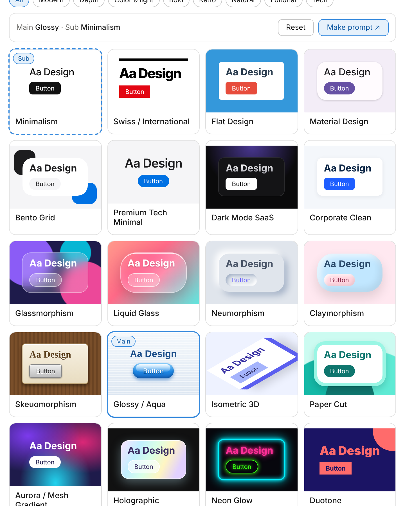
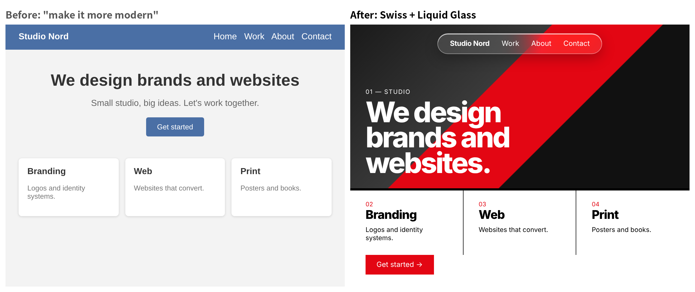

# Design Style Picker 🎨

**English** · [한국어](README.ko.md)

> Stop saying "make it look modern". **See 53 design styles, pick one, and get a precise design prompt** your AI can actually follow.

**Don't know the name of a design style?** That's exactly what this skill is for.

An [Agent Skill](https://skills.sh) for Claude, Claude Code, Codex, Cursor, Gemini CLI and any other agent that supports `SKILL.md`.



---

## Why

Most of us don't know the names of design styles, so we ask AI for something "more polished", "modern" or "premium", and get the same generic result every time.

Design Style Picker shows **53 styles as live preview cards**, including glassmorphism, neo-brutalism, bento grid, Swiss, Y2K, liquid glass and glossy. You pick one main style plus an optional secondary style. The skill then writes a **specific prompt** that names the hex palette, corner radius, shadows, typography and things to avoid, and offers to apply it to your work.

## Install

### Easiest: ask your AI

Paste this into Claude Code, Codex, Cursor, Gemini CLI or any agent that has a terminal:

```
Install the skill from https://github.com/eminoart/design-style-picker
```

The repo ships [AGENTS.md](AGENTS.md), [CLAUDE.md](CLAUDE.md) and [INSTALL.md](INSTALL.md), so the agent knows what to run.

### One command

```bash
npx skills add eminoart/design-style-picker -g -y
```

### Other ways

```bash
# macOS / Linux / WSL
curl -fsSL https://raw.githubusercontent.com/eminoart/design-style-picker/main/install.sh | bash
```
```powershell
# Windows PowerShell
irm https://raw.githubusercontent.com/eminoart/design-style-picker/main/install.ps1 | iex
```

| Tool | How to install |
|---|---|
| Claude Code | Command above, or copy to `~/.claude/skills/design-style-picker/` |
| Codex (CLI, IDE, app) | Command above, or copy to `~/.agents/skills/design-style-picker/` |
| Cursor | Command above, or copy to `~/.cursor/skills/`, `~/.claude/skills/` or `.agents/skills/` |
| Gemini CLI | Command above, or copy to `~/.gemini/skills/` or `~/.agents/skills/` |
| **Claude app** (claude.ai, desktop) | Download [`dist/design-style-picker.zip`](https://github.com/eminoart/design-style-picker/raw/main/dist/design-style-picker.zip), then upload it in the Skills section of Settings |
| **ChatGPT** (web, app) | Create a Project or GPT, paste `SKILL.md` into its instructions, and upload `styles.md` and `gallery.html` as files |

Full details: [INSTALL.md](INSTALL.md)

## How to use

Talk the way you normally would:

```
Make this landing page look more modern
Show me design styles
I want my pitch deck to feel premium
```

1. **Browse.** In the Claude app, the gallery appears right in the chat. Coding tools open it in your browser. Every style shows **the same screen** (menu, headline, button, cards), so you compare styles, not content.
2. **Make it yours.** Switch the use tab (web page, slide, poster) and type your own headline. Every preview updates. Mood chips such as "Polished", "Premium" and "Cute" narrow 53 styles to 4.
3. **Compare.** Collect up to 4 styles. They appear large, side by side, at the top.
4. **Pick.** Mark one main style and, if you like, one secondary style.
5. **Get the prompt.** You get an explanation and an English prompt right away, with no follow-up questions. The target comes from the use tab you chose, or from the conversation.
6. **Apply.** If the session already has design work in progress (a page, code, a deck, a screenshot), the skill uses it as the base and writes the prompt for that exact work. A multiple-choice popup then asks: apply it now, just keep the prompt, or pick another style. With nothing in progress, it offers to build a quick example in your chosen format.

> Explanations follow the language you write in (English or Korean). The generated prompts are always in English, because AI design tools follow English style terms most reliably.

## Real-world examples

### 1. Restyle a landing page (Claude Code, Cursor, Codex)

> **You:** Make this landing page more modern
> **AI:** For "modern", good candidates are Dark SaaS, Bento Grid, Swiss and Glassmorphism. *(opens the gallery)*
> **You:** *(clicks)* Main: Swiss, Secondary: Liquid Glass
> **AI:** *(writes the prompt)* Apply this to `index.html` now?
> **You:** Yes



Generated prompt (excerpt):

```
Style — Swiss International Typographic (main, ~70%):
Strict 12-column grid with visible alignment, asymmetric layouts and flush-left
ragged-right text. Large, tight grotesk headlines... Palette: white #FFFFFF,
black #000000 and a single signal red #E30613. No rounded corners, no shadows...

Blend — borrow from Liquid Glass (secondary, ~30%):
Use liquid glass ONLY for floating chrome: the top navigation bar, a toolbar and
at most one floating action control. Thick pill-shaped glass (24-40px radius),
strong backdrop blur, a bright specular highlight along the top edge...
```

### 2. Get a prompt for another tool (v0, Lovable, Bolt, Figma Make)

> **You:** Show me design styles. I'll build the app in v0.
> **AI:** *(gallery)* → you pick **Bento Grid + Dark SaaS**
> **AI:** Gives a UI prompt. Paste it into v0 together with your feature description.

### 3. Pitch deck (Claude, PowerPoint, Google Slides)

> **You:** I want my investor deck to feel premium
> **AI:** Suggests Luxury Black & Gold, Premium Minimal, Elegant Serif and Art Deco.
> **You:** Main: Premium Minimal
> **AI:** Writes a slide-specific prompt (16:9 masters, 18pt+ body text, chart colors), then offers to build or restyle the deck.

### 4. Poster or thumbnail (Midjourney, DALL·E, Imagen, Firefly)

> **You:** A cute poster for my café, I'll make it in Midjourney
> **AI:** You pick **Kawaii**, and it returns keyword-style image prompts:

```
cozy café poster with a smiling coffee cup character, kawaii style, round chubby
shapes with blush marks, candy pastel palette strawberry milk pink and mint,
soft dark-brown outlines, stickers and sparkles, flat soft lighting,
centered composition, high detail --ar 4:5
```

## Included styles (53, in 8 categories)

| Category | Styles |
|---|---|
| Modern & clean | Minimalism, Swiss, Flat, Material, Bento Grid, Premium Tech Minimal, Dark SaaS, Corporate Clean |
| Depth & texture | Glassmorphism, Liquid Glass, Neumorphism, Claymorphism, Skeuomorphism, Glossy / Aqua, Isometric 3D, Paper Cut |
| Color & light | Aurora / Mesh Gradient, Holographic, Neon Glow, Duotone, Soft Pastel, Monochrome, Color Blocking |
| Bold & experimental | Brutalism, Neo-Brutalism, Cyberpunk, Acid Graphics, Bold Typography, Maximalism, Grunge, Collage |
| Retro & vintage | Y2K, Vaporwave, 70s Retro, Pixel / 8-bit, Art Deco, Bauhaus, Memphis, Retro-Futurism, Risograph |
| Natural & warm | Organic, Japandi, Hand-drawn, Watercolor, Kawaii, Flat Illustration |
| Luxury & editorial | Luxury Black & Gold, Elegant Serif, Editorial Magazine, Newspaper |
| Tech | Terminal, Blueprint, Sci-fi HUD |

Want to browse without an AI? Open [`gallery.html`](skills/design-style-picker/assets/gallery.html) in a browser.

## Repository layout

```
design-style-picker/
├── skills/design-style-picker/     # the skill itself
│   ├── SKILL.md                    # workflow + style summary table
│   ├── assets/gallery.html         # 53-style gallery: same-screen previews, compare, ko/en
│   ├── references/styles.md        # full prompt for every style
│   └── scripts/check_ids.py        # keeps style ids in sync
├── dist/design-style-picker.zip    # upload-ready zip for the Claude app
├── install.sh / install.ps1        # installers
├── AGENTS.md / CLAUDE.md / INSTALL.md
└── docs/                           # README images
```

## Contributing

1. Add the style to `references/styles.md`, to the `S` array and the `T` style tokens in `assets/gallery.html`, and to the summary table in `SKILL.md`.
2. Run `python skills/design-style-picker/scripts/check_ids.py`.
3. Rebuild the zip: `cd skills && zip -r ../dist/design-style-picker.zip design-style-picker`.

Pull requests are welcome.

## License

[MIT](LICENSE)
