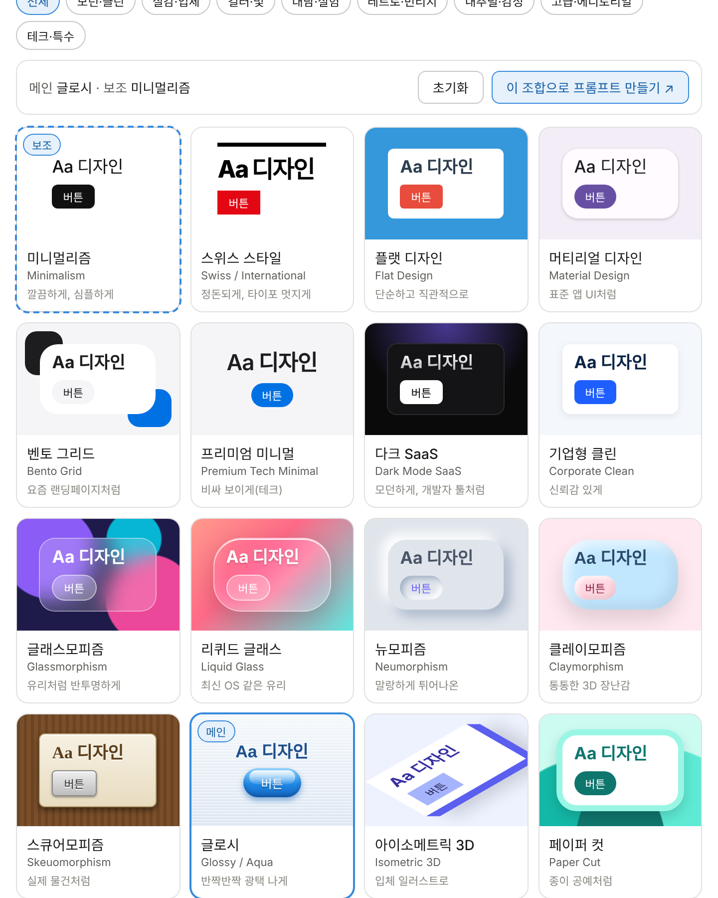

# Design Style Picker 🎨

> "세련되게 해줘", "모던하게 해줘" 대신, **스타일을 눈으로 보고 골라서** 정확한 디자인 프롬프트를 받는 Claude 스킬

[English](#english) · [한국어](#한국어)



---

## 한국어

### 왜 만들었나요?

AI에게 디자인을 맡길 때 우리는 보통 이렇게 말합니다.

- "좀 더 세련되게 해줘"
- "디자인 개선해줘"
- "모던하게 바꿔줘"

문제는 **디자인 스타일 이름을 몰라서** 이렇게밖에 말을 못 한다는 것이고, AI도 매번 비슷하게 무난한 결과만 냅니다.
이 스킬은 53가지 디자인 스타일을 미리보기 카드로 보여 주고, 고른 스타일을 그대로 재현하는 **구체적인 영어 프롬프트**(색상 hex, 모서리, 그림자, 서체, 금지 사항까지)를 만들어 줍니다.

### 어떻게 동작하나요?

1. **갤러리 보기**: 채팅에서는 클릭 가능한 갤러리 위젯이, Claude Code 같은 코딩 도구에서는 브라우저용 HTML 갤러리가 열립니다.
2. **고르기**: 메인 스타일 1개 + 보조 스타일 1개(선택). "세련되게", "힙하게" 같은 칩을 누르면 후보만 걸러 줍니다.
3. **프롬프트 받기**: 추가 질문 없이 바로 **한글 설명 + 영어 프롬프트**를 만듭니다. 웹/앱 UI, 발표 슬라이드, 포스터·이미지, 문서 중 어디에 쓰는지는 대화 맥락으로 판단합니다.
4. **바로 적용**: 작업 중인 코드나 화면이 있으면 그 자리에서 적용할지 물어봅니다.

### 수록 스타일 (53종, 8개 카테고리)

| 카테고리 | 스타일 |
|---|---|
| 모던·클린 | 미니멀리즘, 스위스 스타일, 플랫, 머티리얼, 벤토 그리드, 프리미엄 미니멀, 다크 SaaS, 기업형 클린 |
| 질감·입체 | 글래스모피즘, 리퀴드 글래스, 뉴모피즘, 클레이모피즘, 스큐어모피즘, 글로시, 아이소메트릭 3D, 페이퍼 컷 |
| 컬러·빛 | 오로라 그라디언트, 홀로그래픽, 네온 글로우, 듀오톤, 파스텔, 모노크롬, 컬러 블록 |
| 대담·실험 | 브루탈리즘, 네오브루탈리즘, 사이버펑크, 애시드 그래픽, 볼드 타이포, 맥시멀리즘, 그런지, 콜라주 |
| 레트로·빈티지 | Y2K, 베이퍼웨이브, 70년대 레트로, 픽셀 아트, 아르데코, 바우하우스, 멤피스, 레트로 퓨처리즘, 리소그래프 |
| 내추럴·감성 | 오가닉, 재팬디, 핸드드로잉, 수채화, 카와이, 플랫 일러스트 |
| 고급·에디토리얼 | 럭셔리 블랙앤골드, 엘레강스 세리프, 에디토리얼 매거진, 신문 |
| 테크·특수 | 터미널, 블루프린트, SF HUD |

### 설치

**Claude Code**
```bash
# 개인용 (모든 프로젝트에서 사용)
git clone https://github.com/eminoart/design-style-picker ~/.claude/skills/design-style-picker

# 특정 프로젝트에서만
git clone https://github.com/eminoart/design-style-picker .claude/skills/design-style-picker
```

**Claude 앱 (claude.ai / 데스크톱)**
1. 이 저장소를 zip 으로 내려받습니다 (`Code` → `Download ZIP`). 압축을 푼 뒤 `design-style-picker` 폴더를 다시 zip 으로 묶어도 됩니다.
2. Claude 설정의 스킬(Skills) 메뉴에서 zip 을 업로드합니다.

**그 밖의 에이전트**: `SKILL.md` 형식을 지원하는 도구라면 폴더째 스킬 디렉터리에 넣으면 됩니다.

### 사용 예

```
이 랜딩페이지 좀 세련되게 바꿔줘
디자인 스타일 골라서 프롬프트 만들어줘
발표자료 디자인 어떤 스타일이 좋을지 보여줘
```

갤러리 파일만 따로 보고 싶다면 `assets/gallery.html` 을 브라우저로 열면 됩니다. 카드를 고르고 버튼을 누르면 선택 문장이 클립보드에 복사됩니다.

### 폴더 구조

```
design-style-picker/
├── SKILL.md              # 스킬 동작 순서 + 스타일 요약표
├── assets/gallery.html   # 53종 미리보기 갤러리 (위젯 겸 독립 HTML)
├── references/styles.md  # 스타일별 특징과 영어 프롬프트 원문
├── scripts/check_ids.py  # 파일 간 스타일 id 일치 검사
└── docs/preview.png
```

### 스타일 추가하기

1. `references/styles.md` 에 `### \`new-id\` 한글명 · English` 섹션과 Prompt 블록을 추가합니다.
2. `assets/gallery.html` 의 `S` 배열에 한 줄, CSS 에 `.s-new-id` 규칙을 추가합니다.
3. `SKILL.md` 의 스타일 요약표에 한 줄 추가합니다.
4. `python scripts/check_ids.py` 로 세 파일이 맞는지 확인합니다.

PR 환영합니다!

---

## English

### Why?

When we ask AI for design help we usually say "make it more polished" or "make it modern", because we don't know the names of design styles. The result is generic every time.

**Design Style Picker** shows 53 design styles as live preview cards, lets you pick one main style plus an optional secondary style, and instantly writes a precise prompt (hex palette, radius, shadows, typography, things to avoid) that you can paste into any AI tool or apply right away.

### How it works

1. **Browse**: an interactive gallery widget in chat, or an HTML gallery opened in your browser from coding tools like Claude Code.
2. **Pick**: one main style and up to one secondary style. Mood chips ("polished", "luxurious", "cute"…) filter the candidates.
3. **Get the prompt**: Korean explanation plus an English prompt, with no follow-up questions. The target (web/app UI, slides, poster/image, document) is inferred from the conversation.
4. **Apply**: if there is code or a design in progress, the skill offers to apply the style directly.

### Install

```bash
# Claude Code, personal skills
git clone https://github.com/eminoart/design-style-picker ~/.claude/skills/design-style-picker
```

For the Claude app, download this repo as a zip and upload it from the Skills section of Claude's settings.

### Contributing

Add a style to `references/styles.md`, `assets/gallery.html` (data row and `.s-<id>` CSS) and the summary table in `SKILL.md`, then run `python scripts/check_ids.py`.

## License

[MIT](LICENSE)
